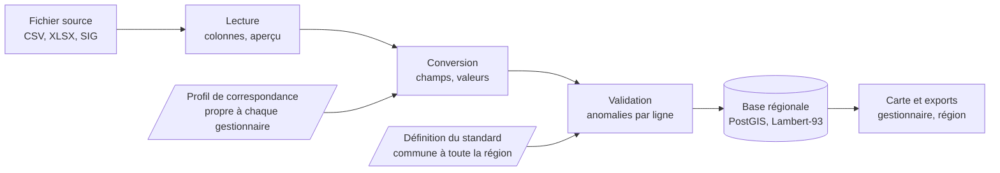

# Harmonisation des données d'éclairage public

Sujet de projet BUT2 - version du 12 octobre 2026

Vous allez construire une application web qui aide les gestionnaires d'éclairage public de la région Sud à décrire leurs lampadaires dans un format commun. Ils les décrivent déjà tous, mais chacun à sa façon, avec ses colonnes et ses codes. Votre outil ramène ces fichiers au même format, puis les affiche sur une carte.

Le commanditaire est Samuel Busson, chercheur au Cerema, un établissement public d'expertise sur l'aménagement et l'environnement. Il travaille sur l'impact de l'éclairage nocturne sur la biodiversité.

Ce sujet est long. Pour une première lecture, les sections « Contexte », « Objectif et périmètre », « Utilisateurs et parcours » et « Premiers pas » suffisent. Lisez « La mise en correspondance, cœur du projet » avant d'écrire du code. Le reste se consulte au fil du projet, quand la question se pose.

## Contexte

**Pourquoi ces données comptent.** La lumière artificielle perturbe la faune nocturne (chauves-souris, insectes, oiseaux migrateurs). Pour définir une « trame noire », c'est-à-dire un réseau de zones préservées de la pollution lumineuse, il faut savoir où sont les points lumineux, ce qu'ils émettent et à quelles heures. La Région Sud et le Cerema ont lancé en octobre 2025 un groupe de travail pour constituer une base régionale harmonisée de l'éclairage public ([support de la réunion de lancement](https://connaissance-territoire.maregionsud.fr/fileadmin/user_upload/Animation_territoriale/Groupes_projets_regionaux/GP_trame-noire/20251010_reunion_delancement-donneesTN.pdf)).

**Pourquoi elles doivent être ouvertes.** La loi pour une République numérique (2016) impose aux collectivités de plus de 3 500 habitants de publier leurs données. En pratique, très peu de jeux de données d'éclairage sont en ligne : [Marseille 2023](https://www.data.gouv.fr/datasets/marseille-eclairage-2023) et [Antibes](https://www.data.gouv.fr/datasets/eclairage-public-a-antibes-juan-les-pins) sont des exceptions. Vous retrouverez ces deux fichiers plus bas : ce sont vos premiers jeux de test.

**Pourquoi c'est difficile.** Les gestionnaires sont des communes, des intercommunalités, des métropoles, des syndicats d'énergie ou des prestataires privés. Leurs données sortent de trois sortes d'outils : un logiciel de GMAO (gestion de maintenance assistée par ordinateur, où l'on suit les pannes et les interventions), un SIG (système d'information géographique, c'est-à-dire un logiciel de cartographie comme QGIS) ou un simple tableur. Les noms de colonnes, les codes et le niveau de détail changent de l'un à l'autre.

Beaucoup de gestionnaires n'ont ni géomaticien, le spécialiste des données géographiques, ni informaticien. Leur demander de produire eux-mêmes un fichier conforme à un standard ne fonctionne pas : l'outil doit faire ce travail avec eux. Retenez-le pour toute la suite, la personne qui utilisera votre application n'est pas une technicienne.

Le travail mené en région Sud doit nourrir ensuite une réflexion nationale. Un outil qui marche ici pourra donc être repris ailleurs.

## Le standard cible : EclExt

Un géostandard est un document qui fixe la façon de décrire un type de données géographiques, pour que tous les producteurs emploient les mêmes champs et les mêmes codes. Celui de l'éclairage extérieur s'appelle EclExt.

Vous convertissez vers le géostandard national EclExt v1.1 (CNIG, 29 novembre 2022), dans sa déclinaison régionale. Le CNIG est le Conseil national de l'information géolocalisée, l'organisme qui publie ces standards. Le document de référence est le [PDF du standard](https://cnig.gouv.fr/IMG/pdf/cnig_eclext_v1_1.pdf) : en cas de doute, c'est lui qui fait foi, pas le résumé ci-dessous.

**Le standard n'existe que sous forme de PDF.** Le [dépôt du schéma](https://github.com/cnigfr/schema-eclairage-exterieur) ne contient qu'un README et un lien vers ce PDF. Il n'y a pas de version lisible par une machine (ni Table Schema, ni JSON Schema). Votre première tâche est donc d'en écrire une.

**La déclinaison régionale n'est pas publiée.** Elle précise quels champs sont retenus et lesquels sont obligatoires, et il faut la demander à Samuel Busson. En attendant, travaillez sur la v1.1 nationale et faites lire à l'application sa cible dans un fichier de configuration : vous pourrez alors en changer sans réécrire le code.

### Ce que le standard décrit

Le standard décrit quatre classes, c'est-à-dire quatre types d'objets. `PointLumineux` est la classe principale : une ligne par point lumineux, soit un luminaire et sa source (la lampe), avec sa position. `ProfilNocturne`, `PlageVariation` et `ProfilContientPlage` décrivent la programmation horaire (abaissement, extinction en cœur de nuit). Concentrez-vous sur `PointLumineux` ; les trois autres sont une extension.

`PointLumineux` a douze attributs obligatoires.

| Attribut | Type | Contenu |
| --- | --- | --- |
| `geometrie` | Point | Position de la source, sinon du support. Lambert-93 (EPSG:2154) en métropole |
| `statut` | Liste | `functional`, `decommissioned`, `dismantled`, `projected`, `underConstruction`... |
| `eclairagePublic` | Booléen | Public ou privé |
| `usage` | Liste | Catégories de l'arrêté du 27/12/2018 : `A` voirie et sécurité, `B1` patrimoine, `B3` parcs et jardins, `C` sport, `E` stationnement... |
| `typeSource` | Liste | `LED`, `SHP` sodium haute pression, `SBP`, `IM` iodures métalliques, `VM` vapeur de mercure, `FLUO`, `HAL`... |
| `structure` | Liste | `LANT` lanterne, `PROJ` projecteur, `BOR` borne, `APP` applique, `EN` encastré, `BL` boule... |
| `support` | Liste | `MAT`, `MUR`, `POT` poteau, `SOL`, `CAT` caténaire, `OUV` ouvrage... |
| `temperatureCouleur` | Entier | En kelvins |
| `puissance` | Décimal | Puissance nominale, en watts |
| `valideDe` | Date | Début de validité des informations, au format AAAAMMJJ |
| `extinctionNuit` | Booléen | Extinction en cœur de nuit |
| `estAdaptatif` | Booléen | Éclairage adaptatif (détection de présence, télégestion) |

Le type « Liste » veut dire que la valeur se choisit parmi des codes fixés par le standard. Les listes extensibles acceptent deux codes spéciaux : `XX` (inconnu) et `AU` (autre).

Deux systèmes de coordonnées reviennent dans tout le sujet. Le WGS 84 (EPSG:4326) est celui du GPS : une latitude et une longitude, en degrés. Le Lambert-93 (EPSG:2154) est la projection officielle de la France métropolitaine : un X et un Y, en mètres. Passer de l'un à l'autre s'appelle une reprojection, et le code EPSG est le numéro qui désigne chaque système dans les logiciels de cartographie.

Les attributs optionnels sont `fabricant`, `modele`, `photometrie`, `hauteurFeu` (m), `fluxSource` et `fluxLuminaire` (lumens), `cie3`, `ulrNominal` et `ulrInstalle` (ratios entre 0 et 1), `inclinaisonMax` et `inclinaisonInstallee` (degrés), `datePremiereInstallation`, `valideJusque`, `profilNocturne`, `eclairageAdaptatif`. Vous n'avez pas à connaître ce vocabulaire d'éclairagiste pour démarrer : le PDF décrit chaque attribut.

Le standard exige aussi des métadonnées sur le jeu livré : producteur identifié par son SIREN, date d'actualisation, licence, emprise géographique.

## Objectif et périmètre

Vous développez une interface web où un gestionnaire dépose son fichier tel qu'il est, indique avec l'aide de l'outil à quoi correspond chaque colonne, et récupère ses données au format EclExt, affichées sur une carte.

L'application remplit quatre fonctions :

1. **Collecter** : recevoir les fichiers des gestionnaires, quels que soient leur format et leur structure.
2. **Mettre en correspondance** : relier les colonnes et les valeurs du fichier source aux champs et aux codes du standard. L'outil propose, l'humain valide.
3. **Convertir et contrôler** : produire le jeu de données standardisé et dire clairement ce qui est conforme, ce qui manque et ce qui est incohérent.
4. **Agréger et visualiser** : verser le résultat dans une base régionale commune et l'afficher sur une carte, par gestionnaire puis pour toute la région.

**Ce qui est dans le périmètre.** La classe `PointLumineux`, les formats de fichiers courants, la correspondance des champs et des valeurs, la validation, l'export et la carte.

**Ce qui n'y est pas.** La saisie ou la correction des données lampadaire par lampadaire : l'outil convertit, il ne remplace pas le logiciel de gestion du gestionnaire. La publication automatique sur data.gouv.fr ou DataSud (le portail de données ouvertes de la région), les calculs de pollution lumineuse et les profils nocturnes sont hors du socle. Ils peuvent devenir des extensions si le temps le permet.

**Le critère de réussite.** Une personne qui n'est ni informaticienne ni géomaticienne convertit le fichier de sa commune en moins d'une demi-heure, sans aide, et comprend le rapport qu'elle obtient.

## Utilisateurs et parcours

L'application a trois types d'utilisateurs, et le premier est celui pour qui tout doit être simple.

| Utilisateur | Qui | Ce qu'il fait |
| --- | --- | --- |
| Gestionnaire | Agent d'une commune, d'une intercommunalité, d'un syndicat d'énergie ; rarement informaticien | Dépose ses fichiers, valide les correspondances, consulte son rapport et sa carte, télécharge son jeu standardisé |
| Animateur régional | Région Sud, Cerema | Suit les dépôts, consulte la carte régionale agrégée, exporte la base régionale, maintient la définition du standard |
| Visiteur | Grand public, chercheurs | Consulte la carte des données que les gestionnaires ont accepté de publier |

Voici le parcours type d'un gestionnaire.

1. Il se connecte au compte de son organisme.
2. Il dépose un fichier exporté de son logiciel (CSV, tableur, couche SIG).
3. L'outil lit le fichier et lui montre ce qu'il a compris : nombre de lignes, colonnes détectées, aperçu des valeurs, position des points sur une carte.
4. L'outil propose une correspondance entre chaque colonne et un champ du standard. Le gestionnaire accepte, corrige ou ignore chaque proposition.
5. Pour les champs à liste fermée, l'outil propose une correspondance entre les valeurs du fichier et les codes du standard. Le gestionnaire valide de la même façon.
6. L'outil convertit et affiche un rapport : lignes conformes, champs obligatoires manquants, valeurs rejetées avec leur numéro de ligne.
7. Le gestionnaire corrige ses correspondances si besoin et relance, puis télécharge son jeu standardisé et le verse dans la base régionale.

Les correspondances validées sont enregistrées. L'année suivante, le même gestionnaire dépose un nouvel export du même logiciel : l'outil réapplique son profil et il n'a plus qu'à vérifier.

## Fonctionnalités attendues

Faites fonctionner le socle de bout en bout sur un fichier CSV avant d'attaquer la moindre extension : un parcours complet et simple vaut mieux que six fonctions à moitié faites. La colonne « Niveau » donne l'ordre, le socle d'abord, puis les extensions 1, puis les extensions 2.

| Fonction | Ce que ça recouvre | Niveau |
| --- | --- | --- |
| Dépôt de fichier | CSV avec détection du séparateur et de l'encodage ; le fichier brut est conservé tel quel | Socle |
| Aperçu du fichier | Colonnes, types devinés, taux de remplissage, valeurs distinctes les plus fréquentes | Socle |
| Correspondance des champs | Écran colonne source vers champ EclExt, avec choix « ignorer » et « valeur constante pour tout le fichier » | Socle |
| Correspondance des valeurs | Pour chaque champ à liste fermée, valeur source vers code du standard | Socle |
| Coordonnées | Détection du système de coordonnées et reprojection en Lambert-93 | Socle |
| Validation | Champs obligatoires, types, bornes, codes autorisés ; rapport lisible par un non-informaticien | Socle |
| Export | Jeu standardisé en CSV et GeoJSON, plus le rapport de validation | Socle |
| Carte du gestionnaire | Ses points sur un fond de carte, avec fiche au clic | Socle |
| Profils de correspondance | Enregistrement et réapplication d'un profil à un nouveau dépôt | Socle |
| Suggestions automatiques | Proposition de correspondance par similarité de noms et analyse des valeurs | Socle |
| Comptes et droits | Un gestionnaire ne voit que ses dépôts ; l'animateur voit tout | Extension 1 |
| Autres formats | XLSX, GeoJSON, Shapefile zippé, GeoPackage en entrée ; GeoPackage en sortie | Extension 1 |
| Carte régionale | Agrégation de tous les dépôts validés, filtres par type de source, puissance, gestionnaire | Extension 1 |
| Suggestions par IA | Un modèle de langage propose les correspondances à partir des noms de colonnes et d'un échantillon | Extension 2 |
| Tableau de bord régional | Taux de couverture, taux de remplissage par champ, part de LED, suivi des dépôts | Extension 2 |
| Profils nocturnes | Prise en charge des classes `ProfilNocturne` et `PlageVariation` | Extension 2 |
| Métadonnées et publication | Génération de la fiche de métadonnées exigée par le standard, préparation d'un dépôt sur DataSud | Extension 2 |

## La mise en correspondance, cœur du projet

Convertir un fichier, c'est résoudre cinq problèmes différents, et le fichier ouvert de Marseille les illustre presque tous. Il contient sept colonnes : `COLLECTIVITE_NOM`, `COLLECTIVITE_SIRET`, `CODE_OUVRAGE`, `DOMAINE`, `CATEGORIE_OUVRAGE`, `LATITUDE`, `LONGITUDE`. Le tableau montre où va chacune dans EclExt, et ce qu'il faut faire pour l'y amener.

| Colonne de Marseille | Exemples de valeurs | Cible EclExt | Travail à faire |
| --- | --- | --- | --- |
| `COLLECTIVITE_NOM`, `COLLECTIVITE_SIRET` | Ville de Marseille, 21130055300016 | Métadonnées du jeu | Ce n'est pas un attribut du point : même valeur sur toutes les lignes. Le SIREN est formé des 9 premiers chiffres du SIRET |
| `CODE_OUVRAGE` | 63837-A, 48645, L100 | Identifiant du point | À conserver pour retrouver le point dans le fichier d'origine |
| `DOMAINE` | Eclairage public, Illuminations, Mobilier urbain, vide | `usage` | Correspondance de valeurs : « Eclairage public » vers `A`, « Illuminations » vers `B1` ou `B2` ? Le gestionnaire tranche |
| `CATEGORIE_OUVRAGE` | MAT, FACADE, SOL, POTEAU BOIS, POTEAU BETON, TREILLIS METALLIQUE, MEL SUR FACADE | `support` | Correspondance de valeurs : FACADE vers `MUR`, POTEAU BOIS et POTEAU BETON vers `POT`. Plusieurs valeurs source vers un même code |
| `LATITUDE`, `LONGITUDE` | 43.2997, 5.3635 | `geometrie` | Deux colonnes vers un seul champ, et reprojection de WGS 84 (EPSG:4326) vers Lambert-93 (EPSG:2154) |
| (absent) |  | `typeSource`, `puissance`, `temperatureCouleur`, `statut`... | Champs obligatoires sans source dans le fichier |

### Les cinq problèmes

1. **Champ vers champ.** Relier une colonne à un attribut. Parfois plusieurs colonnes vont vers un seul champ (latitude et longitude), parfois une colonne alimente deux champs.
2. **Valeur vers valeur.** Traduire le vocabulaire du gestionnaire en codes du standard. C'est le travail le plus long : chaque gestionnaire a ses libellés, ses abréviations et ses fautes de frappe.
3. **Transformations.** Reprojection des coordonnées, format des dates (`12/03/2019` vers `20190312`), unités (kW vers W), virgule ou point décimal, « oui / non » vers booléen.
4. **Constantes.** Une information vraie pour tout le fichier et absente des colonnes : `eclairagePublic` vaut vrai pour tout le parc d'une commune.
5. **Champs manquants.** Le fichier de Marseille ne dit rien de la puissance ni du type de source, pourtant obligatoires. Faut-il rejeter le fichier, accepter avec le code `XX`, ou distinguer « conforme » et « partiel » ? Vous prendrez cette décision avec le commanditaire, et elle détermine ce que le rapport de validation affiche.

### Un piège réel

Le fichier d'Antibes contient des colonnes `longitude` et `latitude` dont les valeurs sont 2031919.53 et 3163361.48. Ce ne sont pas des degrés mais des mètres, dans une projection conique conforme (probablement RGF93 CC44, EPSG:3944, à vérifier). Le nom d'une colonne ne suffit jamais : regardez les valeurs.

### Le profil de correspondance

Toutes ces décisions sont enregistrées dans un objet réutilisable, séparé du code : le profil de correspondance. C'est à vous de concevoir sa forme exacte. En voici une ébauche pour fixer les idées.

```json
{
  "gestionnaire": "211300553",
  "cible": "eclext-1.1",
  "constantes": { "eclairagePublic": true },
  "champs": {
    "support": {
      "source": "CATEGORIE_OUVRAGE",
      "valeurs": { "MAT": "MAT", "FACADE": "MUR", "POTEAU BOIS": "POT", "POTEAU BETON": "POT" },
      "defaut": "XX"
    },
    "geometrie": {
      "source": ["LONGITUDE", "LATITUDE"],
      "transformation": "reprojection",
      "depuis": "EPSG:4326"
    }
  }
}
```

### La suggestion automatique

Construisez-la par paliers, du plus simple au plus ambitieux. Chaque palier doit fonctionner sans le suivant.

1. **Par les noms.** Normaliser les noms de colonnes (minuscules, sans accents ni ponctuation), les comparer aux noms des champs et à un dictionnaire de synonymes (« puiss », « P_W », « watt » vers `puissance`). Une distance d'édition suffit, c'est-à-dire le nombre de caractères à modifier pour passer d'un mot à l'autre.
2. **Par les valeurs.** Une colonne dont les valeurs sont LED, SHP, IM est un type de source. Des entiers entre 1 800 et 6 500 sont sans doute une température de couleur. Deux colonnes autour de 43 et de 5 sont une latitude et une longitude en région Sud.
3. **Par l'historique.** Les correspondances déjà validées par d'autres gestionnaires enrichissent le dictionnaire : deux communes équipées du même logiciel ont les mêmes colonnes.
4. **Par un modèle de langage (extension).** Vous lui envoyez les noms de colonnes, quelques valeurs d'exemple et la description du standard ; il renvoie des propositions en JSON avec une justification. N'envoyez jamais le fichier entier.

Dans tous les cas, la suggestion est une proposition affichée avec son niveau de confiance, et rien n'est converti sans validation humaine.

Pour savoir si un palier apporte quelque chose, mesurez-le : établissez à la main les correspondances des fichiers ouverts, puis comptez combien de suggestions sont justes.

## Données pour démarrer

Quatre jeux de données ouverts suffisent pour commencer, et ils sont assez différents pour servir de jeux de test.

| Jeu de données | Format | Colonnes | Intérêt pour le projet |
| --- | --- | --- | --- |
| [Marseille 2023](https://www.data.gouv.fr/datasets/marseille-eclairage-2023) | CSV, virgule, 6,4 Mo | 7 colonnes, coordonnées en WGS 84 | Cas simple et volumineux : peu de champs, beaucoup de points. Bon premier fichier |
| [Antibes Juan-les-Pins](https://www.data.gouv.fr/datasets/eclairage-public-a-antibes-juan-les-pins) | CSV et XLSX, 9 473 lignes | 10 colonnes, dont le numéro d'armoire de commande ; coordonnées projetées | Noms de colonnes longs avec espaces et accents, coordonnées trompeuses, identifiant réparti sur trois colonnes |
| [Vallée des Baux-Alpilles](https://www.data.gouv.fr/datasets/points-lumineux-eclairage-public-de-la-communaute-de-communes-vallee-des-baux-alpilles-ccvba) | Shapefile, flux WFS | ZA, commune, hauteur, puissance, marque du luminaire | Format SIG, et des champs techniques à relier à `hauteurFeu`, `puissance`, `fabricant` |
| [SYANE, Haute-Savoie](https://www.data.gouv.fr/datasets/points-lumineux-declairage-public-exterieur-dont-le-syane-est-exploitant-haute-savoie) | CSV et GeoJSON, Lambert-93 | Déjà conforme à EclExt | Exemple de ce que l'outil doit produire. Hors région, mais c'est la référence pour le format de sortie |

Les trois premiers sont sous des licences différentes : Licence Ouverte 2.0 pour Marseille et Antibes, ODbL (Open Database License) pour la Vallée des Baux-Alpilles. La base agrégée doit donc garder, pour chaque point, son producteur et sa licence.

Ces fichiers publics sont pauvres : aucun des trois jeux régionaux ne contient le type de source ni la température de couleur. Les exports réels des gestionnaires sont plus riches et plus désordonnés. Demandez-en deux ou trois au commanditaire dès la première réunion, anonymisés si nécessaire.

En complément, fabriquez vos propres fichiers de test : un petit CSV d'une vingtaine de lignes par cas difficile (point-virgule et encodage Windows-1252, dates françaises, puissances en kW, lignes sans coordonnées, doublons). Ils serviront aux tests automatisés.

## Repères techniques

Le principe d'architecture à retenir : le code ne connaît ni le standard ni les gestionnaires. Il applique un profil de correspondance à un fichier pour produire des données conformes à une définition de standard, et ces deux éléments sont des données, pas du code. Accueillir un nouveau gestionnaire ou changer de version du standard ne doit donc demander aucune ligne de PHP.



Le fichier traverse quatre étapes identiques pour tout le monde. Seuls le profil, propre au gestionnaire, et la définition du standard changent.

### La définition du standard

Un fichier (JSON ou YAML) décrit chaque champ cible : nom, type, caractère obligatoire, bornes, liste des codes autorisés avec leur libellé, synonymes connus. L'écran de correspondance, la validation et les suggestions le lisent tous les trois. Passer de la v1.1 nationale à la déclinaison régionale revient alors à changer ce fichier. Le format [Table Schema](https://specs.frictionlessdata.io/table-schema/), utilisé par schema.data.gouv.fr, est un bon point de départ.

### Les données à stocker

| Entité | Contenu |
| --- | --- |
| Gestionnaire | Organisme, SIREN, comptes utilisateurs |
| Dépôt | Fichier brut conservé, date, auteur, état (reçu, en cours de correspondance, validé, versé) |
| Profil de correspondance | Les décisions validées, liées à un gestionnaire, versionnées |
| Point lumineux | La ligne standardisée, avec sa géométrie, son dépôt d'origine et l'identifiant de la ligne source |
| Rapport de validation | Anomalies par ligne et par champ, compteurs |

Chaque point garde le lien vers son dépôt et sa ligne d'origine : c'est ce qui permet d'expliquer une valeur, de rejouer une conversion et de remplacer proprement un dépôt par un plus récent.

### Points techniques à anticiper

- Stockez les points dans une base relationnelle avec extension spatiale (PostgreSQL et PostGIS). Les points ont une géométrie : la base sait la manipuler, ce qui évite de tout recalculer à la main et sert directement la carte.
- Ne réécrivez pas les formules de reprojection. En PHP, le plus simple est de confier la reprojection à PostGIS (fonction `ST_Transform`) ; la bibliothèque proj4php existe aussi. Stockez en Lambert-93 comme le demande le standard, affichez en WGS 84 comme l'attendent les bibliothèques de cartographie web.
- Attendez-vous à des fichiers tous différents : séparateur, encodage et ligne d'en-tête varient. Les formats SIG (Shapefile, GeoPackage) se lisent avec GDAL, la bibliothèque libre de lecture des formats géographiques, plutôt qu'avec du code maison.
- Pour la carte, prenez Leaflet ou MapLibre avec un fond OpenStreetMap. Plusieurs dizaines de milliers de points ne s'affichent pas un par un : prévoyez un regroupement par zoom (clustering) ou des tuiles vectorielles pour la carte régionale.
- Un fichier de plusieurs mégaoctets ne se traite pas dans le navigateur ni en une seule requête bloquante. L'aperçu travaille sur un échantillon, la conversion complète s'exécute côté serveur.
- Écrivez la conversion comme une fonction pure : elle reçoit (fichier, profil, standard), rend (données, rapport), et ne touche à rien d'autre. Elle se teste alors très bien de façon automatisée avec les petits fichiers de test, et c'est là que les tests ont le plus de valeur.
- Si vous utilisez un modèle de langage, appelez-le derrière une interface que l'on peut désactiver. L'application doit rester utilisable sans lui, et la clé d'API ne va jamais dans le dépôt Git.

### En PHP sans framework

L'application est écrite en PHP, sans framework : la pile technique est fixée par l'équipe pédagogique. Ce que le framework aurait apporté, vous l'organisez vous-mêmes, et vous le décidez dès le début.

- Donnez à l'application un point d'entrée unique (`index.php`) qui aiguille les requêtes, et séparez nettement trois couches : la logique de conversion, l'accès à la base, les pages. La conversion ne doit dépendre ni de `$_POST` ni de `$_FILES`, sinon elle n'est pas testable.
- Accédez à la base avec PDO et le pilote PostgreSQL, en requêtes préparées partout, sans exception. Les géométries s'insèrent et se lisent avec les fonctions PostGIS (`ST_MakePoint`, `ST_Transform`, `ST_AsGeoJSON`).
- À chaque dépôt de fichier, vérifiez la taille et le type, stockez hors de la racine web avec un nom généré, et ne réutilisez jamais le nom envoyé. Réglez les limites `upload_max_filesize` et `post_max_size` de PHP pour des fichiers de plusieurs mégaoctets.
- Lisez un gros CSV ligne par ligne avec `fgetcsv` au lieu de le charger en mémoire, insérez par lots dans une transaction, et surveillez `memory_limit` et `max_execution_time`.
- PHP ne devine pas l'encodage seul : détectez-le avec `mb_detect_encoding` et convertissez en UTF-8 dès la lecture.
- PHP ne lit pas nativement un Shapefile ou un GeoPackage. La voie réaliste est d'appeler l'outil en ligne de commande `ogr2ogr` (GDAL) pour le convertir en CSV ou en GeoJSON, puis de reprendre le parcours normal.
- Pour les comptes : sessions PHP, `password_hash` et `password_verify`, jeton anti-CSRF sur chaque formulaire. Passez à `htmlspecialchars` tout ce qui vient d'un fichier déposé avant de l'afficher, car son contenu est une saisie d'utilisateur comme une autre.
- Testez la couche de conversion avec PHPUnit, lancé par l'intégration continue.

Sans framework ne veut pas dire sans outil. Le dépôt fournit déjà Composer avec les outils de développement (PHPUnit, PHPStan, PHP-CS-Fixer), un environnement Docker avec PostGIS et une intégration continue : [CONTRIBUTING.md](CONTRIBUTING.md) explique comment les installer et s'en servir. Avant d'ajouter une bibliothèque à l'application elle-même, par exemple pour lire les fichiers XLSX, demandez l'accord de l'équipe pédagogique.

## Livrables et organisation

Le projet est réussi si le commanditaire peut faire convertir un vrai fichier par un vrai gestionnaire, et si une autre équipe peut reprendre le code l'an prochain.

| Livrable | Contenu |
| --- | --- |
| Dépôt Git | Code, historique lisible, intégration continue qui lance les tests |
| Application | Installable en une commande (par exemple avec Docker Compose), avec un jeu de démonstration |
| Définition du standard | Le fichier décrivant EclExt v1.1, réutilisable en dehors du projet |
| Profils de correspondance | Ceux des jeux ouverts de Marseille, d'Antibes et de la Vallée des Baux-Alpilles, validés à la main |
| Jeux de test | Les petits fichiers de cas difficiles et les tests automatisés associés |
| Guide du gestionnaire | Deux pages, sans vocabulaire informatique, testées sur quelqu'un d'extérieur au projet |
| Documentation technique | Architecture, modèle de données, comment ajouter un champ ou un format |
| Démonstration | Conversion en direct d'un fichier devant le commanditaire |

**Façon de travailler.** Avancez par tranches verticales : une tranche traverse toutes les couches, de la base à l'écran, pour un seul parcours. Commencez par un parcours complet et rudimentaire (dépôt d'un CSV, correspondance à la main, export), puis améliorez-le. Montrez au commanditaire une version qui tourne à chaque point d'étape, même incomplète. Tenez une liste des décisions prises avec lui : le traitement des champs manquants, par exemple, se décide une fois et s'écrit.

Les règles de travail dans le dépôt (branches, pull requests, messages de commit) sont dans [CONTRIBUTING.md](CONTRIBUTING.md).

Le calendrier, la taille des groupes et les modalités d'évaluation sont communiqués par l'équipe pédagogique.

## Premiers pas

Les premières séances servent à comprendre les données avant d'écrire l'application : on ne conçoit pas un écran de correspondance sans avoir fait une correspondance à la main.

- [ ] Lire les chapitres du PDF EclExt consacrés au modèle de données et aux listes de valeurs
- [ ] Télécharger les quatre jeux ouverts et les ouvrir dans un tableur, puis dans QGIS
- [ ] Convertir à la main le fichier de Marseille vers EclExt, dans un tableur, en notant chaque décision et chaque blocage
- [ ] Faire de même pour Antibes et comparer : qu'est-ce qui était identique, qu'est-ce qui a changé ?
- [ ] Comparer le résultat obtenu au fichier du SYANE, qui est déjà conforme
- [ ] Écrire la première version du fichier de définition du standard pour `PointLumineux`
- [ ] Dessiner les écrans du parcours gestionnaire sur papier et les faire relire
- [ ] Préparer la liste de questions pour la première réunion avec le commanditaire
- [ ] Écrire un script minimal, sans interface, qui applique un profil de correspondance écrit à la main au fichier de Marseille et produit un CSV

Ce dernier script est le cœur de l'application. Une fois qu'il fonctionne et qu'il est testé, l'interface web vient se poser dessus.

## Questions à poser au commanditaire

Le sujet ne tranche pas ces points, et les réponses changent ce que vous construirez. Emportez la liste à la première réunion.

- [ ] Quelle est la liste des champs de la déclinaison régionale, et lesquels sont obligatoires ?
- [ ] Que fait-on d'un fichier auquel il manque des champs obligatoires : rejet, acceptation partielle, code `XX` ?
- [ ] Peut-on obtenir deux ou trois exports réels de gestionnaires, et de quels logiciels viennent-ils ?
- [ ] Les gestionnaires veulent conserver des informations absentes du standard (armoire de commande, départ, type d'implantation). Faut-il les garder dans la base régionale ?
- [ ] Qui a le droit de voir quoi ? Un dépôt est-il public dès qu'il est validé, ou seulement si le gestionnaire l'accepte ?
- [ ] Quand un gestionnaire redépose un fichier, remplace-t-il le précédent ou garde-t-on l'historique ?
- [ ] Où l'application sera-t-elle hébergée après le projet, et par qui ?
- [ ] L'usage d'un modèle de langage hébergé à l'extérieur est-il acceptable pour les données des gestionnaires ?
- [ ] Le critère de réussite proposé plus haut (une conversion en moins d'une demi-heure par un non-spécialiste) lui convient-il ?
- [ ] La base agrégée doit-elle être reversée sur DataSud, et sous quelle forme ?

## Ressources

**Le standard**

- [Géostandard EclExt v1.1, document complet (CNIG)](https://cnig.gouv.fr/IMG/pdf/cnig_eclext_v1_1.pdf)
- [Dépôt GitHub du schéma](https://github.com/cnigfr/schema-eclairage-exterieur)
- [Fiche du schéma sur schema.data.gouv.fr](https://schema.data.gouv.fr/cnigfr/schema-eclairage-exterieur/)
- Arrêté du 27 décembre 2018 relatif à la prévention, à la réduction et à la limitation des nuisances lumineuses, dont le standard reprend les catégories d'usage

**La démarche régionale**

- [Support de la réunion de lancement du 10 octobre 2025, Région Sud et Cerema](https://connaissance-territoire.maregionsud.fr/fileadmin/user_upload/Animation_territoriale/Groupes_projets_regionaux/GP_trame-noire/20251010_reunion_delancement-donneesTN.pdf)

**Les jeux de données**

- [Marseille, éclairage 2023](https://www.data.gouv.fr/datasets/marseille-eclairage-2023)
- [Antibes Juan-les-Pins, éclairage public](https://www.data.gouv.fr/datasets/eclairage-public-a-antibes-juan-les-pins)
- [Vallée des Baux-Alpilles, points lumineux](https://www.data.gouv.fr/datasets/points-lumineux-eclairage-public-de-la-communaute-de-communes-vallee-des-baux-alpilles-ccvba)
- [SYANE, points lumineux au format EclExt](https://www.data.gouv.fr/datasets/points-lumineux-declairage-public-exterieur-dont-le-syane-est-exploitant-haute-savoie)

**Outils**

- [Table Schema](https://specs.frictionlessdata.io/table-schema/), format de description de données tabulaires
- QGIS pour ouvrir et vérifier les fichiers géographiques ; GDAL et PROJ pour les lire et les reprojeter
